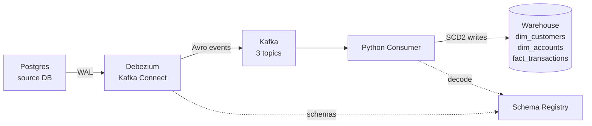

# CDC Pipeline: Postgres → Debezium → Kafka → Data Warehouse (SCD2)

A real-time change-data-capture pipeline that streams every insert/update/delete from an operational Postgres database into a warehouse with full historical tracking (SCD Type 2), using Kafka and Debezium.

## Why this project

Banks, telecoms, and most companies with an operational database face the same problem: moving data out of a transactional system into an analytics warehouse without impacting the live application, and without losing history. This project implements that pipeline end-to-end.

## Architecture



## What it demonstrates

- **Change Data Capture**: Postgres logical replication (WAL) → Debezium, no polling, no app-side triggers
- **Event streaming**: Kafka topics, partitioning by primary key, consumer groups, offset management
- **Schema evolution**: Avro + Schema Registry, compatible vs breaking schema changes
- **Dimensional modeling**: SCD Type 2 (`valid_from`/`valid_to`/`is_current`) for slowly-changing attributes, append-only fact table for transactions
- **Reliability**: idempotent writes via source LSN, at-least-once delivery + idempotency = effective exactly-once, dead-letter handling for poison messages
- **Data quality**: automated invariant checks (no duplicate current rows, no overlapping validity periods, referential integrity)

## Stack

Docker Compose · Postgres 16 · Debezium 2.7 · Kafka (KRaft) · Schema Registry · Avro · Python

## Quick start

```bash
python reset.py                                    # starts everything, registers the connector
python warehouse/generator/generate.py --delay 0.5  # simulates app traffic
python warehouse/consumer/scd2_consumer.py          # streams Kafka -> warehouse
python warehouse/tests/data_quality.py              # validates invariants
```

Kafka UI: http://localhost:8080 · Kafka Connect REST API: http://localhost:8083 · Schema Registry: http://localhost:8081

## Example: time-travel query

What did customer #7 look like on a given date?

```sql
SELECT * FROM warehouse.dim_customers
WHERE customer_id = 7
  AND valid_from <= '2025-03-15 00:00:00+00'
  AND (valid_to IS NULL OR valid_to > '2025-03-15 00:00:00+00');
```

## Design decisions

- **`REPLICA IDENTITY FULL`** on source tables: required so Debezium's `before` payload contains the full old row, not just the primary key. Trade-off: more WAL volume per write.
- **Primary key as Kafka message key**: guarantees all changes to the same row arrive in order within a partition — critical for correct SCD2 history.
- **Idempotency via `source_lsn`**: every warehouse write is guarded by the source LSN, so replaying a message after a crash never creates a duplicate "current" row.
- **Commit order (DB commit → Kafka offset commit)**: ensures a crash between the two just replays the last message safely, rather than silently losing it.

## What I'd add for production

- Multi-broker Kafka cluster (replication factor 3)
- Monitoring (Prometheus/Grafana on Connect + consumer lag)
- Orchestrated schema migration process (not just alter-table-and-hope)
- A real warehouse engine (ClickHouse/BigQuery) instead of a second Postgres schema